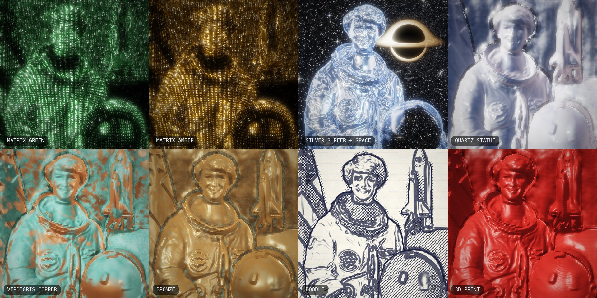
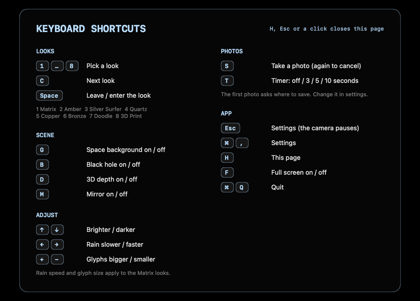
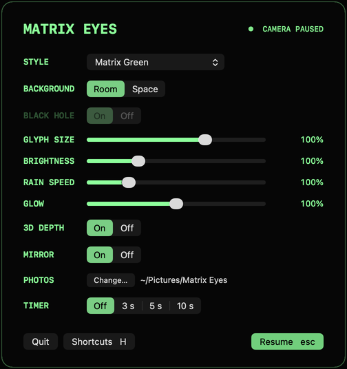

# Matrix Eyes

Real-time camera filters for macOS that turn your room into a 3D world. The signature look is the Matrix "digital rain": every surface carries its own flow of falling code, laid out in perspective, like the corridor shot in the film. Press a key and the same 3D scene becomes a chrome Silver Surfer in deep space, a quartz statue, verdigris copper, bronze, an ink doodle or a 3D print.



<sub>All eight looks, rendered offline with `--render-test` from the NASA portrait of astronaut Eileen Collins (public domain). On your camera it's you and your room.</sub>

## Install

On an Apple silicon Mac with macOS 14 or newer, paste this into Terminal:

```bash
curl -fsSL https://raw.githubusercontent.com/Narek-versatile/matrix-eyes-macos/main/install.sh | bash
```

It downloads the latest [release](https://github.com/Narek-versatile/matrix-eyes-macos/releases/latest), verifies it, installs it into Applications and opens it. Allow camera access when asked. The [setup guide](SETUP.md) covers updating, uninstalling and troubleshooting.

## The 3D effect

A depth network (Apple's Depth Anything V2, on the Neural Engine) estimates how far away everything is, about 30 times a second. From that, each surface gets code mapped onto it the way the film's 3D artists texture-mapped their sets:

- surfaces facing you (walls, your face and body): columns fall down the surface;
- surfaces seen from the side: columns stay at a fixed depth and get foreshortened;
- floors, desks and ceilings: code streams along the surface toward the camera.

Glyphs shrink with distance, far surfaces fade and soften, near objects (you) glow brighter with a rim light, and silhouettes get bright outlines. Rendering runs on the GPU (Metal) at 60 fps.

## The looks

Press **1–8** (or **C** to cycle):

| Key | Look | What it is |
| --- | --- | --- |
| 1 | **Matrix Green** | The film's digital rain, mapped onto every surface in 3D |
| 2 | **Matrix Amber** | The same rain in amber phosphor |
| 3 | **Silver Surfer** | You as liquid chrome (studio reflections, cold rim light), against space |
| 4 | **Quartz Statue** | Polished white stone: veins, light passing through thin parts, tiny crystal glints |
| 5 | **Verdigris Copper** | Statue-of-Liberty copper: green patina in the crevices, bare metal on the high points |
| 6 | **Bronze** | Cast bronze: dark patina in recesses, polished highlights on raised edges |
| 7 | **Doodle** | Ballpoint on notebook paper: contour lines and hatching that wobble like a hand-drawn animation |
| 8 | **3D Print** | Red PLA with visible layer lines |

The materials use the depth map for shape and the picture's own brightness for fine relief (a face stays a face), so they react to how you move.

**Space** (key **G**, or Background › Space in settings) replaces everything except you with outer space: a dense starfield and a **black hole** (key **B**). You are cut out with Apple's person segmentation, so it works with any look; Silver Surfer turns it on for you. The black hole is ray-traced: light is bent through the Schwarzschild geometry, so the stars behind it are lensed and the glowing accretion disk appears both directly and as the arch warped over and under the shadow, brighter on the side that's spinning toward you.

## Controls

Press **H** in the app for this list as a page. Shortcuts follow the physical key positions, so they work on any keyboard layout (Armenian, Russian, ...), and holding a key doesn't repeat anything except the adjustments (arrows, + and −).



| Key | Action |
| --- | --- |
| Esc or ⌘, | settings menu; the camera stops filming while it's open |
| 1–8, C | pick a look / cycle looks |
| G | space background on / off |
| B | black hole on / off (turns space on if needed) |
| Space | leave / enter the look (a column-by-column wipe over the real camera image) |
| + / − | bigger / smaller glyphs (Matrix looks) |
| ↑ / ↓ | brighter / darker |
| ← / → | slower / faster rain (Matrix looks) |
| D | 3D depth on / off (compare flat vs 3D) |
| M | mirror on / off |
| S | take a photo (shutter flash and sound; saved as a PNG named after the look); pressing it during a countdown cancels |
| T | photo timer: off / 3 / 5 / 10 seconds |
| F | full screen on / off |
| H (or ?) | the keyboard shortcuts page (also a button in settings) |
| ⌘Q | quit |

## Settings



Esc opens the settings menu and stops the camera (its light goes off); the picture keeps animating over the last frame behind the menu. Esc, Enter or a click outside the card resumes. Style, background, black hole, photo folder, photo timer, glyph size, brightness, rain speed, glow, 3D depth and mirror are saved between launches. The **Shortcuts** button opens the keyboard shortcuts page. Settings that don't apply to the current look (glyph size and rain speed outside Matrix, black hole without space) are greyed out.

## Photos

Press **S** to take a photo of exactly what's on screen. The first time, Matrix Eyes asks where to save photos (a normal folder picker, which can create a new folder) and remembers your choice; the photo you just took is kept and saved there. Change the folder any time under Photos in the settings menu (Esc). If the folder is later deleted or can't be written to, it asks again.

**Timer:** press **T** (or use Timer in settings) to choose a 3, 5 or 10 second countdown. Then **S** shows a big number in the middle of the screen, ticks each second and takes the photo at zero, so you can step back and pose. **S** or **Esc** cancels. The countdown numbers, hint and flash are overlays, so they never appear in the photo.

## Build from source

Needs macOS 14+, an Apple silicon Mac and Xcode.

```bash
git clone https://github.com/Narek-versatile/matrix-eyes-macos.git
cd matrix-eyes-macos
./build.sh
open "Matrix Eyes.app"
```

The first build downloads the depth model (see below). `scripts/package-release.sh` builds the zip and checksum that go on the Releases page.

## Depth model

`scripts/fetch-model.sh` downloads Apple's [Depth Anything V2 Small for Core ML](https://huggingface.co/apple/coreml-depth-anything-v2-small) (Float16, 49.8 MB, Apache-2.0) into `Models/` and checks it against the published SHA-256 hashes; `build.sh` runs it when the model is missing. It's not committed to this repo. Without it the app still runs, just flat. Attribution is in [THIRD_PARTY_NOTICES.md](THIRD_PARTY_NOTICES.md).

## Testing without the camera

To try the look on a still image instead of the camera (prints GPU time per frame):

```bash
"Matrix Eyes.app/Contents/MacOS/MatrixEyes" --render-test input.png output.png 2940 1912 8
```

`MATRIX_SELFTEST=1` launches the real app, cycles through every look, space, the black hole and the settings menu, then quits (exit code 0 means it all ran). `MATRIX_KEYTEST=<folder>` sends real key events (photo, timer, key repeat, a non-Latin keyboard layout, the shortcuts page, clicks reaching the settings) and logs each result; photos go to that folder. Neither touches your saved settings. Environment variables pick what `--render-test` renders: `MATRIX_STYLE` (`green`, `amber`, `chrome`, `quartz`, `copper`, `bronze`, `doodle`, `print`), `MATRIX_SPACE=1` for the space background, `MATRIX_BH=0` to leave out the black hole, `MATRIX_FLAT=1` to skip depth, `MATRIX_DEPTH_OUT=depth.png` / `MATRIX_MASK_OUT=mask.png` to save the depth map / person cut-out. To draw the settings menu to a PNG:

```bash
"Matrix Eyes.app/Contents/MacOS/MatrixEyes" --settings-preview settings.png chrome
"Matrix Eyes.app/Contents/MacOS/MatrixEyes" --shortcuts-preview shortcuts.png chrome
```

## How it works

- `Sources/Camera.swift`: AVFoundation capture, frames go straight into Metal textures.
- `Sources/DepthEstimator.swift`: runs the depth model on camera frames in the background (Neural Engine), dropping frames while busy.
- `Sources/GlyphAtlas.swift`: draws the character set (mirrored half-width katakana, digits, a few symbols) into a texture.
- `Sources/PersonMasker.swift`: Vision person segmentation (only runs while the space background is on).
- `Sources/Style.swift`: the eight looks: their palettes, tone curves and settings.
- `Sources/SettingsOverlay.swift`, `Sources/Preferences.swift`: the Esc menu and the saved settings.
- `Resources/Shaders.metal`, `Space.metal`, `Materials.metal` (concatenated at launch): per frame:
  1. Camera → smoothed luminance buffer with mipmaps (per-cell averages plus whole-frame auto exposure).
  2. Depth → metres, with an edge-preserving blur and a temporal dead band so static surfaces hold still.
  3. Geometry: per-pixel 3D position, surface normal and silhouette edges.
  4. Person cut-out smoothed over time; outer space (starfield + ray-traced black hole) when it's on.
  5. The look: either the digital rain (picks a mapping per pixel from its normal: front / side / floor, lays falling code streams in those surface coordinates with partial perspective, lit by scene brightness, a key light, rim light and depth fog), or a material (depth normals plus luminance relief, crevice darkening from comparing each depth with its surroundings, then the chrome / quartz / copper / bronze / doodle / plastic shading).
  6. Two-level bloom for the glow.
  7. Composite: the style's tone curve (the film's grade for green, a filmic curve for materials, plain for the doodle), glow, vignette and the brief fade when you switch looks.

## License

[MIT](LICENSE). The bundled depth model is Apache-2.0 (see [THIRD_PARTY_NOTICES.md](THIRD_PARTY_NOTICES.md)). "The Matrix" and its imagery belong to their owners; this project is an unaffiliated fan tribute.
