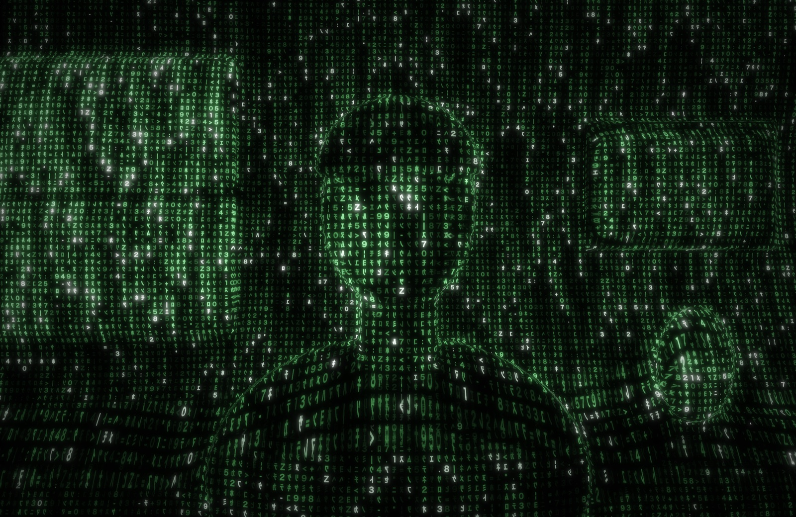
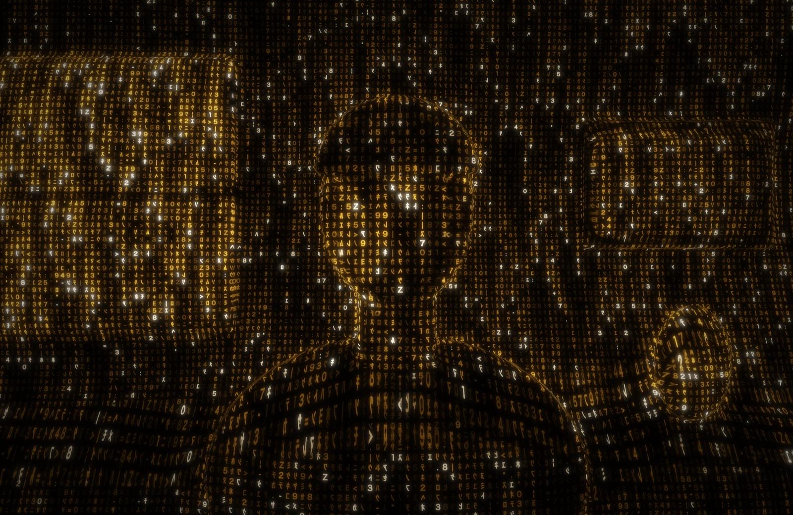

# Matrix Eyes

Real-time Matrix "digital rain" camera filter for macOS. It turns the MacBook camera feed into a 3D world made of falling code, like the corridor shot in the film: every surface carries its own flow of characters, laid out in perspective. Comes in the film's green and in amber.




<sub>Previews rendered from a drawn test scene with `--render-test`; on your camera it's you and your room.</sub>

## Install

On an Apple silicon Mac with macOS 14 or newer, paste this into Terminal:

```bash
curl -fsSL https://raw.githubusercontent.com/Narek-versatile/matrix-eyes-macos/main/install.sh | bash
```

It downloads the latest [release](https://github.com/Narek-versatile/matrix-eyes-macos/releases/latest), verifies it, installs it into Applications and opens it. Allow camera access when asked. The [setup guide](SETUP.md) covers updating, uninstalling and troubleshooting.

## The 3D effect

A depth network (Apple's Depth Anything V2, on the Neural Engine) estimates how far away everything is, about 30 times a second. From that, each surface gets code mapped onto it the way the film's 3D artists texture-mapped their sets:

- surfaces facing you (walls, your face and body): columns fall down the surface;
- surfaces seen from the side: columns stay at a fixed depth and get foreshortened;
- floors, desks and ceilings: code streams along the surface toward the camera.

Glyphs shrink with distance, far surfaces fade and soften, near objects (you) glow brighter with a rim light, and silhouettes get bright outlines. Rendering runs on the GPU (Metal) at 60 fps.

## Controls

| Key | Action |
| --- | --- |
| Esc or ⌘, | settings menu; the camera stops filming while it's open |
| Space | leave / enter the Matrix (the code rains in or out over the real camera image) |
| C | green / amber |
| + / − | bigger / smaller glyphs |
| ↑ / ↓ | brighter / darker |
| ← / → | slower / faster rain |
| D | 3D depth on / off (compare flat vs 3D) |
| M | mirror on / off |
| S | save a snapshot to Pictures › Matrix Eyes |
| F | full screen on / off |
| H | show / hide the help |
| ⌘Q | quit |

## Settings


Esc opens the settings menu and stops the camera (its light goes off); the code keeps raining over the last frame behind the menu. Esc, Enter or a click outside the card resumes. Color, glyph size, brightness, rain speed, glow, 3D depth and mirror are saved between launches.

## Build from source

Needs macOS 14+, an Apple silicon Mac and Xcode.

```bash
git clone https://github.com/Narek-versatile/matrix-eyes-macos.git
cd matrix-eyes-macos
./build.sh
open "Matrix Eyes.app"
```

The first build downloads the depth model (see below). `scripts/package-release.sh` builds the zip and checksum that go on the Releases page.

## Depth model

`scripts/fetch-model.sh` downloads Apple's [Depth Anything V2 Small for Core ML](https://huggingface.co/apple/coreml-depth-anything-v2-small) (Float16, 49.8 MB, Apache-2.0) into `Models/` and checks it against the published SHA-256 hashes; `build.sh` runs it when the model is missing. It's not committed to this repo. Without it the app still runs, just flat. Attribution is in [THIRD_PARTY_NOTICES.md](THIRD_PARTY_NOTICES.md).

## Testing without the camera

To try the look on a still image instead of the camera (prints GPU time per frame):

```bash
"Matrix Eyes.app/Contents/MacOS/MatrixEyes" --render-test input.png output.png 2940 1912 8
```

Set `MATRIX_THEME=amber` for the amber palette, `MATRIX_FLAT=1` to skip depth, or `MATRIX_DEPTH_OUT=depth.png` to save the depth map. To draw the settings menu to a PNG:

```bash
"Matrix Eyes.app/Contents/MacOS/MatrixEyes" --settings-preview settings.png amber
```

## How it works

- `Sources/Camera.swift`: AVFoundation capture, frames go straight into Metal textures.
- `Sources/DepthEstimator.swift`: runs the depth model on camera frames in the background (Neural Engine), dropping frames while busy.
- `Sources/GlyphAtlas.swift`: draws the character set (mirrored half-width katakana, digits, a few symbols) into a texture.
- `Sources/ColorTheme.swift`: the green and amber palettes.
- `Sources/SettingsOverlay.swift`, `Sources/Preferences.swift`: the Esc menu and the saved settings.
- `Resources/Shaders.metal`: per frame:
  1. Camera → smoothed luminance buffer with mipmaps (per-cell averages plus whole-frame auto exposure).
  2. Depth → metres, with an edge-preserving blur and a temporal dead band so static surfaces hold still.
  3. Geometry: per-pixel 3D position, surface normal and silhouette edges.
  4. Code pass: picks a mapping per pixel from its normal (front / side / floor), lays falling code streams in those surface coordinates with partial perspective, lit by scene brightness, a key light, rim light and depth fog. Surfaces seen nearly edge-on fall back to the front mapping so they don't smear.
  5. Two-level bloom for the glow.
  6. Composite: the theme color (for green, the film's grade with red and blue at about half of green) rolls off toward white in the highlights, plus glow and a vignette.
