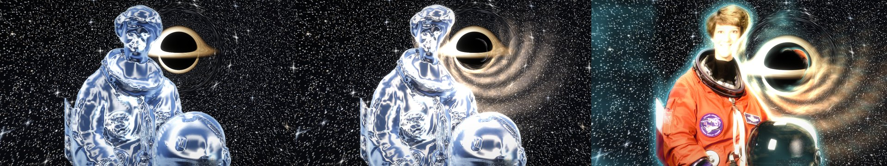

# Matrix Eyes

Real-time camera filters for macOS that turn your room into a 3D world. The signature look is the Matrix "digital rain": every surface carries its own flow of falling code, laid out in perspective, like the corridor shot in the film. Press a key and the same 3D scene becomes a chrome Silver Surfer in deep space next to a ray-traced black hole that bends you, pulls you in and lights you up, a quartz statue, verdigris copper, bronze, an ink doodle or a 3D print. Or walk an endlessly twisting corridor as a hologram.


<sub>The eight key looks, rendered offline with `--render-test` from the NASA portrait of astronaut Eileen Collins (public domain). On your camera it's you and your room.</sub>

Matrix Eyes shares its engine and its settings panel with [Matrix Eyes Cam](https://github.com/Narek-versatile/matrix-eyes-cam), the virtual webcam that brings these looks into Google Meet, Zoom and FaceTime calls.

## Install

On an Apple silicon Mac with macOS 14 or newer, paste this into Terminal:

```bash
curl -fsSL https://raw.githubusercontent.com/Narek-versatile/matrix-eyes-macos/main/install.sh | bash
```

It downloads the latest [release](https://github.com/Narek-versatile/matrix-eyes-macos/releases/latest), verifies it, installs it into Applications and opens it. Allow camera access when asked. The [setup guide](SETUP.md) covers updating, uninstalling and troubleshooting.

## The 3D effect

A depth network (Apple's Depth Anything V2, on the Neural Engine) estimates how far away everything is, about 30 times a second. From that, each surface gets code mapped onto it the way the film's 3D artists texture-mapped their sets:

- surfaces facing you (walls, your face and body): columns fall down the surface;
- surfaces seen from the side: columns stay at a fixed depth and get foreshortened;
- floors, desks and ceilings: code streams along the surface toward the camera.

Glyphs shrink with distance, far surfaces fade and soften, near objects (you) glow brighter with a rim light, and silhouettes get bright outlines. Rendering runs on the GPU (Metal) at 60 fps.

## The looks

Press **1–8** for the key looks, **C** to go through all of them:

| Key | Look | What it is |
| --- | --- | --- |
| 1 | **Matrix** | The film's digital rain, mapped onto every surface in 3D |
| 2 | **Matrix Amber** | The same rain in amber phosphor |
| 3 | **Silver Surfer in space** | You as liquid chrome (studio reflections, cold rim light), next to a black hole |
| 4 | **Quartz statue** | Polished white stone: veins, light passing through thin parts, tiny crystal glints |
| 5 | **Verdigris copper** | Statue-of-Liberty copper: green patina in the crevices, bare metal on the high points |
| 6 | **Bronze** | Cast bronze: dark patina in recesses, polished highlights on raised edges |
| 7 | **Doodle** | Ballpoint on notebook paper: contour lines and hatching that wobble like a hand-drawn animation |
| 8 | **3D print** | Red PLA with visible layer lines |

The materials use the depth map for shape and the picture's own brightness for fine relief (a face stays a face), so they react to how you move.

**C** also visits the scene looks: Neo in the rain, a hologram in the infinite corridor, a statue on Escher's stairs, bronze in the fractal cathedral, neon synthwave, made of galaxy, falling into the black hole, aurora noir, fire spirit, ghost trails and more. Every look is built from the same parts, and you can change any of them in settings (Esc) and save your own:

- **Background:** your room (as it is, blurred, tidied, or turned into the look itself), space, Matrix rain, aurora, synthwave, or an impossible space: an infinite corridor that slowly twists, Escher stairs in every direction, a fractal cathedral.
- **You:** as you are (with a colour grade), an effect (edge glow, hologram, neon outline, pixelate, ghost trails), a material, a fill (galaxy, fire, ocean, lava, or your own image or video), or Matrix code.

You are cut out with Apple's person segmentation whenever the background isn't your own room in the look.

## The black hole



<sub>Left: the hole beside you with its interactions off. Middle: gravity bends you, the disk lights you and you're pulled in. Right: the "Falling into the black hole" look.</sub>

In space, press **B** for a black hole. It's ray-traced: light is bent through the Schwarzschild geometry, so the stars behind it are lensed and the glowing accretion disk appears both directly and as the arch warped over and under the shadow, brighter on the side spinning toward you. And it acts on you, each with its own slider in settings:

- **Gravity bends you:** your silhouette is lensed like the stars when you get close.
- **Pulls you in:** wisps of you stream off your edges and spiral into it.
- **Disk lights you:** the accretion disk throws warm light and a rim onto the side of you facing it.

**Drag** on the picture to move it, or press **O** and it orbits your head (Apple's face detection follows you). Its size is a slider too.

## Controls

Press **H** in the app for this list as a page. Shortcuts follow the physical key positions, so they work on any keyboard layout (Armenian, Russian, ...), and holding a key doesn't repeat anything except the adjustments (arrows, + and −).


| Key | Action |
| --- | --- |
| Esc or ⌘, | settings; the camera stops filming while they're open |
| 1–8, C | pick a key look / go to the next look |
| G | space background on / off |
| B | black hole on / off (turns space on if needed) |
| drag | move the black hole |
| O | the black hole orbits your head / stays put |
| Space | leave / enter the look (a column-by-column wipe over the real camera image) |
| + / − | bigger / smaller glyphs (Matrix code) |
| ↑ / ↓ | brighter / darker |
| ← / → | slower / faster rain (Matrix code) |
| D | 3D depth on / off (compare flat vs 3D) |
| M | mirror on / off |
| S | take a photo (shutter flash and sound; saved as a PNG named after the look); pressing it during a countdown cancels |
| T | photo timer: off / 3 / 5 / 10 seconds |
| F | full screen on / off |
| H (or ?) | the keyboard shortcuts page (also a button in settings) |
| ⌘Q | quit |

## Settings


Esc opens settings and stops the camera (its light goes off); the picture keeps animating over the last frame behind them. Esc, Enter or a click outside the card resumes. It's the same panel as in Matrix Eyes Cam, with every control of both apps: the look (pick, save as a new look, reset a built-in one, delete your own), background and its speed, the black hole (size, position, bend, pull, light), what you become and its options, Matrix code colour, glyph size and rain speed, brightness, glow, 3D depth, mirror, and photos (folder, timer). The panel shows only what applies to the current look and takes its colour.

Changes are saved as you make them, per look, in `~/Library/Application Support/Matrix Eyes`; mirroring applies to every look. The two apps keep their own looks. The first launch of version 2 starts from your version 1 settings (look, space, black hole, glyph size, brightness, rain speed, glow, depth, mirror).

## Photos

Press **S** to take a photo of exactly what's on screen. The first time, Matrix Eyes asks where to save photos (a normal folder picker, which can create a new folder) and remembers your choice; the photo you just took is kept and saved there. Change the folder any time under Photos in settings (Esc). If the folder is later deleted or can't be written to, it asks again.

**Timer:** press **T** (or use Timer in settings) to choose a 3, 5 or 10 second countdown. Then **S** shows a big number in the middle of the screen, ticks each second and takes the photo at zero, so you can step back and pose. **S** or **Esc** cancels. The countdown numbers, hint and flash are overlays, so they never appear in the photo.

## Build from source

Needs macOS 14+, an Apple silicon Mac and Xcode.

```bash
git clone https://github.com/Narek-versatile/matrix-eyes-macos.git
cd matrix-eyes-macos
./build.sh
open "Matrix Eyes.app"
```

The first build downloads the depth model (see below). `scripts/package-release.sh` builds the zip and checksum that go on the Releases page.

## Depth model

`scripts/fetch-model.sh` downloads Apple's [Depth Anything V2 Small for Core ML](https://huggingface.co/apple/coreml-depth-anything-v2-small) (Float16, 49.8 MB, Apache-2.0) into `Models/` and checks it against the published SHA-256 hashes; `build.sh` runs it when the model is missing. It's not committed to this repo. Without it the app still runs, just flat. Attribution is in [THIRD_PARTY_NOTICES.md](THIRD_PARTY_NOTICES.md).

## Testing without the camera

To render a look on a still image instead of the camera (prints GPU time per frame):

```bash
"Matrix Eyes.app/Contents/MacOS/MatrixEyes" --render-test input.png output.png 2940 1912 8 look=3 bend=0.8
```

After the optional width, height and seconds, `key=value` pairs pick the look: `look=<1…21>` or `preset=<name>`, `bg` (room, blurred, tidy, sameAsYou, space, matrix, aurora, synthwave, corridor, stairs, cathedral), `subject` (real, effect, material, fill, matrix), `effect`, `material`, `fill`, `grade`, `theme` (green, amber), `bh=0/1`, `hx`, `hy`, `hsize`, `bend`, `pull`, `light`, `glow`, `rows`, `mirror=1`, `media=<image or video>`, `accent=r,g,b`. Version 1's `MATRIX_STYLE`, `MATRIX_SPACE`, `MATRIX_BH`, `MATRIX_GLOW`, `MATRIX_EXPOSURE` and `MATRIX_FLAT` environment variables still work.

`MATRIX_SELFTEST=1` launches the real app, goes through every key look, the black hole, orbiting and the settings menu, then quits; add `MATRIX_SELFTEST_PHOTO_DIR=<folder>` to check photos and the countdown. `MATRIX_KEYTEST=<folder>` sends real key events (photo, timer, key repeat, a non-Latin keyboard layout, looks, B, O, dragging the black hole, G, the shortcuts page, clicks reaching settings) and logs each result; photos go to that folder. With `MATRIX_TEST_IMAGE=<photo>` they use a still photo and never open the camera. None of them touch your saved settings. To draw settings or the shortcuts page to a PNG:

```bash
"Matrix Eyes.app/Contents/MacOS/MatrixEyes" --settings-preview settings.png 3     # with look 3
"Matrix Eyes.app/Contents/MacOS/MatrixEyes" --shortcuts-preview shortcuts.png
```

## How it works

`Sources/Engine` and `Resources/Shaders` are the engine shared with Matrix Eyes Cam. They're developed there and copied here by its `scripts/sync-to-matrix-eyes.sh`, so don't edit them in this repo. `Sources/App` is this app.

- `Engine/Camera.swift`: AVFoundation capture, frames go straight into Metal textures.
- `Engine/DepthEstimator.swift`: runs the depth model on camera frames in the background (Neural Engine), dropping frames while busy.
- `Engine/PersonMasker.swift`: Vision person segmentation and face position, only while a look needs them.
- `Engine/GlyphAtlas.swift`: draws the character set (mirrored half-width katakana, digits, a few symbols) into a texture.
- `Engine/Preset.swift`: what a look is (every setting) and the saved looks; `Engine/LookModel.swift`: the shared settings panel.
- `Engine/Engine.swift` with `Resources/Shaders/*.msl` (concatenated at launch), per frame:
  1. Camera → smoothed luminance buffer with mipmaps (per-cell averages plus whole-frame auto exposure).
  2. Depth → metres, with an edge-preserving blur and a temporal dead band so static surfaces hold still; then per-pixel 3D position, surface normal and silhouette edges.
  3. Person cut-out smoothed over time.
  4. Background: the room in the look, your room (blurred without a halo around you), or a generated scene (starfield with the ray-traced black hole, digital rain, aurora, synthwave, ray-marched corridor / stairs / cathedral).
  5. You: the digital rain (a mapping per pixel from its normal: front / side / floor, falling code streams in those surface coordinates with partial perspective, lit by scene brightness, a key light, rim light and depth fog), a material (depth normals plus luminance relief, crevice darkening, then the chrome / quartz / copper / bronze / doodle / plastic shading), an effect, a fill, or the camera with a grade. Near the black hole your silhouette is lensed and lit by the disk.
  6. Composite with light wrap, ghost trails, and the wisps of you spiralling into the hole.
  7. Two-level bloom, then the final picture: glow, the Space-key wipe, the fade between looks, vignette.
- `App/AppDelegate.swift`: the window, keys, photos; `App/SettingsOverlay.swift`, `App/ShortcutsOverlay.swift`: the Esc menu and the H page.

## License

[MIT](LICENSE). The bundled depth model is Apache-2.0 (see [THIRD_PARTY_NOTICES.md](THIRD_PARTY_NOTICES.md)). "The Matrix" and its imagery belong to their owners; this project is an unaffiliated fan tribute.
